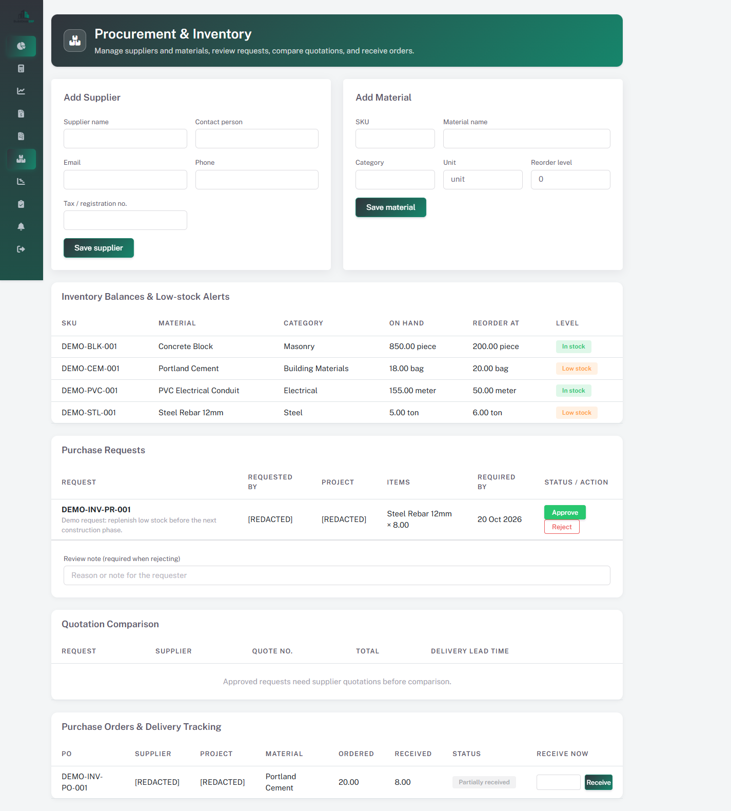

# BuildDesk Construction ERP

A role-based ERP for construction teams. The application covers workforce operations, project delivery, procurement, approvals, payroll, finance, and client billing.

## Contents

- [Roles and access](#roles-and-access)
- [Feature guide](#feature-guide)
- [Screenshots](#screenshots)
- [Technology](#technology)
- [Installation](#installation)
- [Demo data](#demo-data)
- [Reminder schedule](#reminder-schedule)
- [Tests](#tests)
- [Data model overview](#data-model-overview)

## Roles and access

- **Admin**: organization-wide dashboards, payroll and financial review, procurement, approval decisions, project workspace, and sales invoices.
- **HR**: worker and project operations, attendance, advances, payroll tasks, reports, inventory requests, project updates, and approval submissions.
- Routes require an authenticated, active account with the matching role. The sign-in page is available at `/login`.

## Feature guide

### Authentication

| Page | Route | Included features | Screenshot |
|---|---|---|---|
| Sign in | `/login` | Session-based sign-in; protected pages require an active user and the correct Admin/HR role. | [View](screenshots/auth/login.png) |

### Admin

| Page | Route | Included features | Screenshot |
|---|---|---|---|
| Dashboard | `/admin/dashboard` | Workforce and project KPIs, revenue/profit overview, payroll and expense summaries, invoices, attendance trends, recent activity, and shortcuts. | [View](screenshots/admin/dashboard.png) |
| Payroll dashboard | `/admin/payroll-dashboard` | Period and worker/project filters, payroll generation, payroll totals, refresh, and CSV export. Payroll can also be generated through the authenticated utility route `/generate-payroll/{year}/{month}` (no separate screen). | [View](screenshots/admin/payroll/dashboard.png) |
| Payroll summary | `/admin/payroll-summary` | Monthly payroll totals and worker-level summary. | [View](screenshots/admin/payroll/summary.png) |
| Worker profile | `/admin/worker-profile` | Worker payroll/profile information for administrative review. | [View](screenshots/admin/payroll/worker-profile.png) |
| Project expenses | `/admin/expenses` | Browse and manage company/project expenses and their categories. | [View](screenshots/admin/finance/project-expenses.png) |
| Profit & Loss | `/admin/profit-loss` | Review revenue, expenses, payroll cost, and project/company profitability. | [View](screenshots/admin/finance/profit-loss.png) |
| Budget quotations | `/admin/budget-quotations` | Create and manage project quotations, line items, VAT, validity, preview, and print/PDF output. | [View](screenshots/admin/budget-quotations.png) |
| Procurement & inventory | `/admin/procurement` | Maintain suppliers and materials; monitor balances and low stock; review purchase requests; enter/compare supplier quotes; create purchase orders; receive partial/full deliveries. | [View](screenshots/admin/procurement-inventory.png) |
| Project workspace | `/admin/project-workspace` | Project progress, milestones, budget vs actual cost, daily site updates, and project/worker documents. | [View](screenshots/admin/project-workspace.png) |
| Approvals | `/admin/approvals` | Review pending purchase, expense, payroll, and quotation approvals; record decisions and decision history. | [View](screenshots/admin/approvals.png) |
| Notifications | `/admin/notifications` | Review alerts, mark one/all read, and run an authorized reminder scan. | [View](screenshots/admin/notifications.png) |
| Sales invoice form | `/admin/sales-invoices/create` | Create client invoices with project/client/company details, service line items, quantities/prices, configurable VAT (21% default), notes, terms/exclusions, and paid/unpaid/partial status. Existing invoices can be edited at `/admin/sales-invoices/edit/{id}`; invoices can be printed/saved as PDF. | [View](screenshots/admin/sales-invoices/form.png) |
| Sales invoice list | `/admin/sales-invoices` | Search by invoice/client contact, filter by payment status, paginate, review invoice totals, and manage invoices. | [View](screenshots/admin/sales-invoices/list.png) |

### HR

| Page | Route | Included features | Screenshot |
|---|---|---|---|
| HR dashboard | `/hr/dashboard` | Workforce/project KPIs, attendance, medical compliance, payroll and advances summaries, trends, activity, and shortcuts. | [View](screenshots/hr/dashboard.png) |
| Worker list | `/hr/workers` | Search/filter workers, review status and employment details, and open worker actions. | [View](screenshots/hr/workers/list.png) |
| Add/edit worker | `/hr/worker/create`, `/hr/worker/{workerId}/edit` | Maintain worker contact/employment details, hourly/daily/monthly rates, active/inactive/terminated status, and medical certificate issue/expiry dates. Bulk CSV import uses a downloadable template. Workers can be assigned to multiple projects. | [View](screenshots/hr/workers/form.png) |
| Project list | `/hr/projects` | Browse and manage project records. | [View](screenshots/hr/projects/list.png) |
| Add/edit project | `/hr/projects/add`, `/hr/project/{project}/edit` | Maintain project/client, schedule, contract value, estimated cost, and related financial details. Bulk CSV import uses a downloadable template. | [View](screenshots/hr/projects/form.png) |
| Project staffing | `/hr/project-assignment` | Assign workers to projects and manage their assignments. | [View](screenshots/hr/projects/staffing.png) |
| Attendance | `/hr/attendance` | Record daily check-in/out and attendance status by project and worker; track worked hours, overtime (with payroll multiplier support), and client-billable hours separately. Payroll-generation flags prevent attendance from being processed twice. | [View](screenshots/hr/attendance/mark.png) |
| Attendance sheet | `/hr/reports/attendancesheet` | Review attendance records in report/sheet form. | [View](screenshots/hr/reports/attendance-sheet.png) |
| Project-wise attendance | `/hr/reports/projectwiseattendance` | Review attendance grouped and reported by project. | [View](screenshots/hr/reports/project-attendance.png) |
| Client billing report | `/hr/reports/clientbillingsystem` | Review client-billable attendance and billing data. | [View](screenshots/hr/reports/client-billing.png) |
| Worker advances | `/hr/advances`, `/hr/advances/form/{id?}` | Review advance records; create/edit advances, track original and remaining balances/status, and apply deductions through payroll. | [View](screenshots/hr/advances/list.png), [View](screenshots/hr/advances/form.png) |
| Single-worker payroll | `/payroll/single-worker` | Generate/review an individual worker's payroll from the selected period, attendance, and hourly/daily/monthly rate; account for overtime, advances, and manual adjustments. | [View](screenshots/hr/payroll/single-worker.png) |
| Payroll history | `/payroll/history` | Review historical payroll records and period summaries. | [View](screenshots/hr/payroll/history.png) |
| Inventory & purchase requests | `/hr/inventory` | Check stock/reorder levels; submit multi-item purchase requests; issue/return project materials; receive ordered deliveries. | [View](screenshots/hr/inventory.png) |
| Project workspace | `/hr/project-workspace` | Update site progress and milestones, inspect budget/costs, and upload/download project or worker documents. | [View](screenshots/hr/project-workspace.png) |
| Approvals | `/hr/approvals` | Submit expense, draft payroll, and quotation requests; follow request and decision history. Inventory purchase requests also enter the approval flow. | [View](screenshots/hr/approvals.png) |
| Notifications | `/hr/notifications` | Review project, approval, low-stock, document, and other reminders; mark read and run a reminder scan. | [View](screenshots/hr/notifications.png) |

### Cross-module workflows

1. HR submits a purchase request from Inventory; Admin reviews it in Procurement.
2. After approval, Admin records supplier quotations, compares price and delivery lead time, then creates a purchase order.
3. Admin or HR records delivery quantities against open purchase orders. Receipts update the stock ledger; partial deliveries remain open.
4. HR submits expense, payroll, and project quotation requests in Approvals. Admin decisions are recorded in a permanent action history.
5. Project Workspace consolidates site progress, milestones, material cost, finalized project payroll, expenses, budget status, and documents.
6. Notifications surface actionable reminders for pending approvals, deadlines, low stock, expiring records, and unpaid invoices.

## Reminder schedule

The Laravel scheduler runs `erp:generate-reminders` daily at 08:00 and prevents overlapping runs. To activate scheduled reminders in production, configure the host scheduler to invoke Laravel's scheduler every minute from the project directory:

```bash
php artisan schedule:run
```

On Windows, configure Task Scheduler to run `php artisan schedule:run` every minute with the project directory as the working directory.

## Screenshots

Screenshots are organized by role and feature. Each feature table links to a current capture; use those links to open the image. Keep separate captures for important sub-features rather than putting several unrelated pages into one image.

```text
screenshots/
├── admin/
│   ├── dashboard.png
│   ├── payroll/
│   │   ├── dashboard.png
│   │   ├── summary.png
│   │   └── worker-profile.png
│   ├── finance/
│   │   ├── project-expenses.png
│   │   └── profit-loss.png
│   ├── budget-quotations.png
│   ├── procurement-inventory.png
│   ├── project-workspace.png
│   ├── approvals.png
│   ├── notifications.png
│   └── sales-invoices/
│       ├── form.png
│       └── list.png
├── hr/
│   ├── dashboard.png
│   ├── workers/
│   │   ├── list.png
│   │   └── form.png
│   ├── projects/
│   │   ├── list.png
│   │   ├── form.png
│   │   └── staffing.png
│   ├── attendance/mark.png
│   ├── reports/
│   │   ├── attendance-sheet.png
│   │   ├── project-attendance.png
│   │   └── client-billing.png
│   ├── advances/
│   │   ├── list.png
│   │   └── form.png
│   ├── payroll/
│   │   ├── single-worker.png
│   │   └── history.png
│   ├── inventory.png
│   ├── project-workspace.png
│   ├── approvals.png
│   └── notifications.png
└── auth/login.png
```

To embed a captured image in this section, use its repository-relative path:

```markdown

```

Screenshot checklist:

- Use demo/synthetic records, not real worker, client, supplier, or company data.
- Never capture passwords, tokens, browser autofill, private contact details, or other secrets.
- Capture the full relevant page at a consistent desktop viewport; take an additional mobile capture where responsive behavior matters.
- Crop browser/OS chrome and ensure the target feature and its state are readable.
- Use the exact lowercase names and folders in the feature tables; do not overwrite a different feature's screenshot.
- Captures use redacted sample data. Recheck names, contact details, IDs, and dates before replacing or adding screenshots.

## Technology

| Area | Technology |
|---|---|
| Backend | PHP 8.2+, Laravel 12 |
| Interactive UI | Livewire 4 |
| Layout/UI | Bootstrap 5, Sneat-based application assets, custom ERP theme |
| Database | MySQL by default; SQLite can be configured for local/testing use |
| PDF | `barryvdh/laravel-dompdf` |
| Frontend assets | Vite, Node.js, and NPM |

## Installation

### Requirements

- PHP 8.2 or newer with required Laravel extensions
- Composer
- MySQL/MariaDB or another Laravel-supported database
- Node.js and NPM

### Setup

```bash
composer install
npm install
```

Create `.env` from `.env.example` (on PowerShell use `Copy-Item .env.example .env`), set the database connection, then run:

```bash
php artisan key:generate
php artisan migrate
npm run build
php artisan serve
```

Open `http://127.0.0.1:8000/login`. To run the Vite development server while developing, use `npm run dev` in a separate terminal.

## Demo data

The default `DatabaseSeeder` creates the application roles and local demo users. To populate the HR inventory, project workspace, approvals, and notification screens with repeatable sample data, first migrate and seed the base roles/users, then run:

```bash
php artisan db:seed
php artisan db:seed --class="Database\Seeders\HrModuleDemoDataSeeder"
```

The HR module demo seeder requires both an Admin and an HR user. It creates a demo project, sample materials and stock movements, purchase requests/order, milestones, progress updates, approval examples, and HR notifications. It is safe to run again without duplicating those demo records. Avoid running demo seeders against production data.

## Tests

Run the full suite:

```bash
php artisan test
```

Useful focused suites:

```bash
php artisan test tests/Feature/ProcurementInventoryTest.php
php artisan test tests/Feature/ProjectWorkspaceTest.php
php artisan test tests/Feature/ApprovalReminderTest.php
php artisan test tests/Feature/HRModuleDemoDataSeederTest.php
```

## Data model overview

The application stores identity and authorization in `users` and `roles`; workforce and project operations in `workers`, `projects`, `project_worker`, and `attendances`; and finance/payroll data in `worker_advances`, `payroll_batches`, `payrolls`, `payroll_project_breakdowns`, `expense_categories`, `project_expenses`, `budget_items`, `sale_invoices`, and `invoice_items`.

Procurement and delivery use `suppliers`, `materials`, `purchase_requests`, `purchase_request_items`, `supplier_quotations`, `supplier_quotation_items`, `purchase_orders`, `purchase_order_items`, and `inventory_transactions`. Project delivery and collaboration use `project_milestones`, `project_progress_updates`, and `project_documents`. Approval and reminders are persisted in `approval_requests`, `approval_actions`, and `erp_notifications`.

Key relationships include workers assigned to multiple projects, attendance linked to workers and projects, payroll allocated to projects, expenses and delivery costs linked to projects, purchase orders linked to requests and suppliers, and approvals linked to their source records.

## Contact

**Sumaya Akter**  
Full-Stack Software Engineer  
Phone: 01690253986  
Email: [sumaya0akter45@gmail.com](mailto:sumaya0akter45@gmail.com)